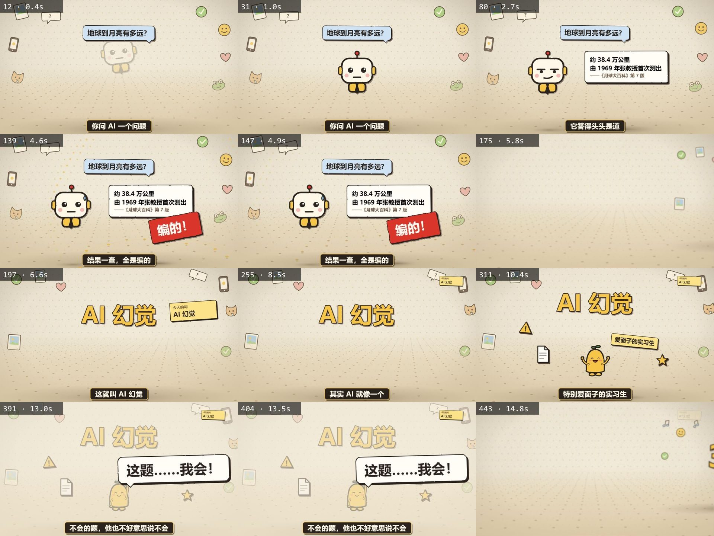
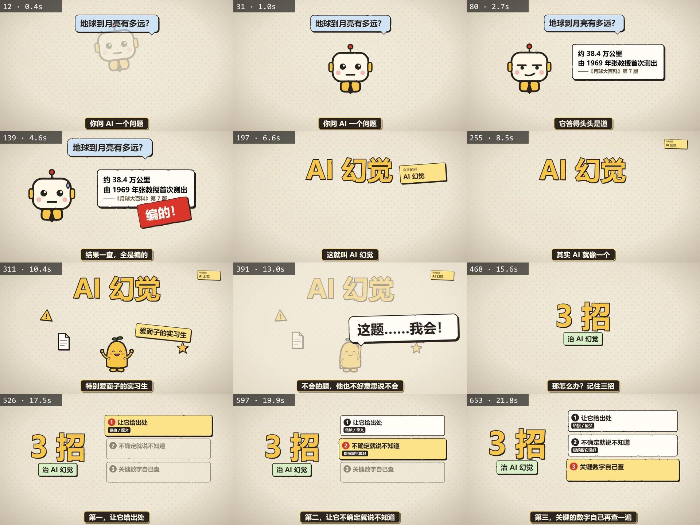
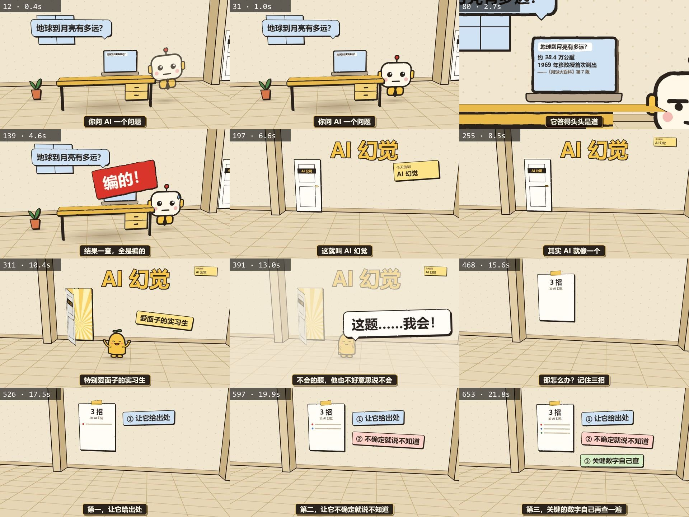
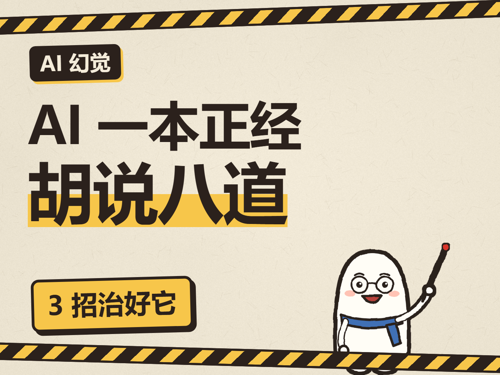
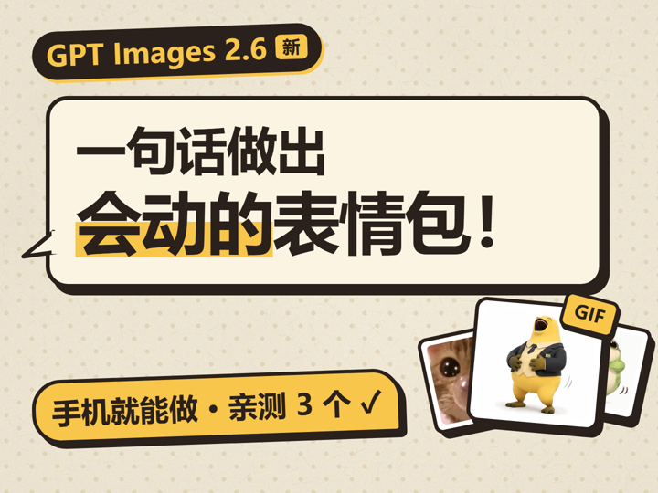

# paper-handdrawn-explainer · 纸张手绘风讲解视频

给一个主题，agent 先写口播稿，你确认后配音、对齐，再用组件库自由搭配，生成纸张手绘风的 Remotion 讲解动画（波点纸底、粗墨线、硬投影、3D 展板空间、黑底黄边字幕），预览确认后导出成片、做封面、给标题和总结。

流程里有三道停止关，agent 不会一路跑到底：

1. 稿子写完 → 等你说“稿子没问题”
2. 预览做好 → 等你说“导出”
3. 导出后给标题和总结 → 等你确认再写回偏好记录

## 三种画面

同一套风格，画面空间可选三种（`src/mode.ts` 切换，说明见 `references/modes.md`）：

- **3D 展板**（默认）：波点走廊里悬着一块块展板，镜头在展板之间推进、平移、转身飞
- **2D 平面**：一整张纸上推拉镜头，大段落之间用有形象的全屏转场
- **3D 实景**：一个办公室 / 街道贯穿全片，镜头一路走、推进电脑屏幕、最后拉远看全景

## 效果

模板自带的 28 秒示例（同一个「AI 幻觉」稿子）三种模式各抽一遍：

| 3D 展板（默认） | 2D 平面 |
|---|---|
|  |  |

| 3D 实景 | 封面 |
|---|---|
|  |  |

上面是抽帧联系表（每格一帧，按时间顺序），改成你自己的稿子后跑 `node scripts/check.mjs --out chk/r1` 会得到同样格式的图，用来审片。

## 封面

**封面不套固定模板。** 每期先定这期的钩子类型（数字损失 / 价格反差 / 认知反转 / 概念对比 / 纯疑问 / 结果承诺），再选构式重排版面。`references/cover-refs/` 收了六种构式的往期封面做骨架参考：

| 数字压字 | 价签居中 | 界面即封面 |
|---|---|---|
|  |  |  |
| **对话气泡** | **实物比喻** | **对比双物** |
|  |  |  |

变的是版式，不变的是：同一张米黄波点纸、同一套粗墨线和硬投影、≤3 色、一句钩子占满画面、缩到 300px 宽还读得清。规则见 `references/export-cover.md`。

## 安装

**Claude Code**：把整个文件夹复制到

- 用户级：`~/.claude/skills/paper-handdrawn-explainer/`（Windows：`C:\Users\<你>\.claude\skills\paper-handdrawn-explainer\`）
- 或项目级：`<项目>/.claude/skills/paper-handdrawn-explainer/`

然后说“用纸张手绘风做一期讲 XX 的视频”。

**其他 agent**（Codex、Cursor、自己写的 agent）：让它先读 `SKILL.md`，按里面的步骤和 `references/` 执行。所有路径都是相对 skill 目录的，不依赖某台电脑。

## 依赖

| 依赖 | 用途 | 必需 |
|---|---|---|
| Node.js 20.19+ / 22.13+ | Remotion 工程 | 是 |
| ffmpeg / ffprobe | 混音、导出检查、素材处理 | 导出时需要（没有会退回 `npx remotion ffmpeg`，但缺滤镜） |
| Python + funasr | 真人录音识别切句（`scripts/asr.py`） | 用真人录音时，装法见 `assets/template/requirements.txt` |
| 一个 TTS | 没有真人录音时配音 | 可选；都没有就用 `estimate-align.mjs` 按字数估时长先做画面 |

第一次 `npm install` 后渲染时，Remotion 会下载一个无头浏览器，国内网络可能要代理。

## 文件

```
SKILL.md                 主流程（agent 从这里开始）
references/              写稿、配音、分镜、风格、动效、组件目录、音效、审片、导出封面、踩坑
assets/template/         可直接运行的 Remotion 工程模板（含组件库 src/parts、音效 public/sfx、脚本 scripts）
assets/taste-log.md      偏好记录模板，复制到每期工程里
docs/                    README 用的效果图
LICENSE                  MIT
```

模板自带同一段 28 秒示例（AI 幻觉主题）的三种做法，复制出来 `npm install` 后：

```bash
node scripts/estimate-align.mjs
npx tsc --noEmit
node scripts/check.mjs --out chk/r1
npm run dev
```

就能看到效果。把 `src/mode.ts` 改成 `"flat2d"` 或 `"room3d"` 再跑一遍抽帧，就是另外两种画面。

## 换成你自己的人设 / 角色 / 风格

- **人设**：讲解人怎么自称、怎么称呼观众、账号名、固定结尾，第一次用时 agent 会问你一次，记在工程的 `taste-log.md`“人设”里，以后不再问。不想定就用“我 / 你 / 关注我，下期见”
- **角色**：模板自带一套代码画的通用角色（讲解员、小同学、老板，共 11 个姿势），由 `scripts/make-cast.mjs` 生成，改里面的 `LOOK` 就能换颜色和配件。有自己的 IP 形象，就按同样的文件名（stick、chin、shrug、thumb、tea、kid、q、shock、sad、hand、boss）把透明底 PNG 放进 `public/img/c/`，再跑 `node scripts/make-cast.mjs --sizes`
- **颜色**：`src/parts/palette.ts`
- **偏好**：在 `taste-log.md` 里写你的要求，agent 每期开工前会先读，**你的话优先于 skill 里的默认规则**

## 许可证

代码用 MIT，见 [LICENSE](LICENSE)。

**Remotion 的授权是另一回事，不受这里的 MIT 影响。** 这个模板靠 Remotion 渲染视频，而 Remotion 不是完全免费的：按它官方的许可证，**个人、员工不超过 3 人的营利组织、非营利组织**可以免费用（商用也算），规模更大的营利组织需要买 Company License。要在公司项目里用，先确认自己的实体属于哪一档：

- 许可证页面：<https://www.remotion.dev/license>
- 原文：<https://github.com/remotion-dev/remotion/blob/main/LICENSE.md>

**素材**：`assets/template/public/img/paper.png`、`grain.png`（纸纹）、`public/img/c/`（角色）、`public/sfx/` 里 100 多个音效，都是自制或代码生成，随 MIT 一起授权，可以随便替换。

## 还没实测的部分

这里如实写清楚，别当成全流程都验过：

- **真人录音 → 识别 → 对齐**（`scripts/asr.py` + `scripts/align.mjs`）：写了，但没在干净环境跑通过
- **混音**（`scripts/mix-audio.mjs`）：写了，没实测；背景音乐那个分支是半成品
- **整片导出**（`remotion render` + 混音合并）：没出过完整成片

已验证的只有这条链：`npm install` 装得上 → `estimate-align.mjs` 按字数估时长生成 `voice.ts` → `tsc --noEmit` 类型检查过 → `check.mjs` 三种模式都能抽帧出图（README 上面那几张图就是它生成的）。

遇到问题先查 `references/pitfalls.md`，里面是真实踩过的坑。

## 你做完一期，分享前检查

- `scripts/lines.json`（台词）、`src/scenes/`（分镜）、`taste-log.md`（偏好记录）里有没有你的真实姓名、公司名、客户名
- 画面里的截图有没有露出账号名、后台地址、真实价格或 token 额度
- 封面缩到手机信息流大小看一眼，钩子还认不认得出
- 角色、音效、纸纹都是代码生成的，可以随视频随意用
