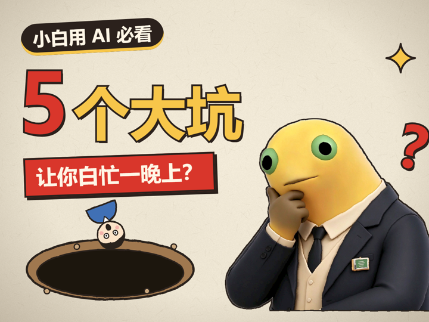
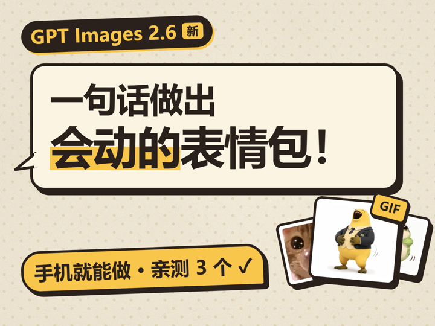

# 导出、封面、标题和总结

**只有用户说了“导出”才做这一步。** 预览阶段不做封面。

## 1. 导出

```bash
npx tsc --noEmit
npx remotion render Main out/video-muted.mp4 --muted
node scripts/mix-audio.mjs out/video-muted.mp4 out/video.mp4
```

第一次渲染要下浏览器，国内网络下不下来就加 `--browser-executable="C:/Program Files/Google/Chrome/Application/chrome.exe"`（细节见 pitfalls.md）。

- 画面先无声导出（带音轨导出会崩），`mix-audio.mjs` 再把配音（`public/voice.mp3`，没有就用静音）+ `Sfx.tsx` 的音效混好合并
- 导出后检查：

```bash
ffprobe -v error -select_streams v:0 -show_entries stream=pix_fmt,color_range,color_space,width,height,r_frame_rate -of default=nw=1 out/video.mp4
```

  要看到 `yuv420p`、`tv`、`bt709`、1920×1080、30/1。不对就是 `remotion.config.ts` 被改了
- 时长要和配音对上（`ffprobe -show_entries format=duration`）
- 从成片抽 3~5 帧（开头、一个爆点、结尾）看一眼，确认音画都在
- 可选：`node scripts/review.mjs out/video.mp4 --out review --script scripts/lines.json` 做量化检查

导出卡住、崩溃、发白看 `pitfalls.md` 的“导出”一节。

## 2. 封面

**封面是每期重新设计的一次性版面，不是填模板。** `src/Cover.tsx` 里那套「主题签 + 大字钩子 + 黄色利益点 + 人物」只是一个**起点示例**，填 `COVER` 常量能出图，但连着几期都长一样，观众在信息流里扫过去认不出这期讲什么。**每期先想“这期的画面记忆点是什么”，再选构式，然后改 `Cover.tsx` 的 JSX 重排版面。**

### 2.1 先定钩子类型

从稿子里挑最狠的那一句，判断它属于哪种钩子。**钩子类型决定构式**，不是反过来：

| 钩子类型 | 长什么样 | 例 |
|---|---|---|
| 数字损失 | “5 个大坑”“3 个白忙的晚上” | 数字最大，单位是痛 |
| 价格反差 | “一亿 token 2.5 块” | 数字本身就是钩子 |
| 认知反转 | “赚的根本不是会用 AI 的钱” | 把常识摔碎 |
| 概念对比 | “API 和 SDK 到底差在哪” | A vs B |
| 纯疑问 | “开源又是啥” | 观众自己有问题 |
| 结果承诺 | “一句话做出会动的表情包” | 给一个可验证的结果 |

### 2.2 构式库

**先打开对应的参考图看一遍**（`references/cover-refs/`，都是往期封面，可直接照搬骨架、换内容）：

| # | 构式 | 什么内容适合 | 怎么搭 | 参考图 |
|---|---|---|---|---|
| 1 | **数字压字** | 清单、坑、招数、步骤 | 巨大的数字（红）+ 彩色马克笔字（黄），下面压一条红底白字的“后果”句，左下放道具演后果，人物在右下托腮/扶额 | `01-count.png` |
| 2 | **价签居中** | 价格、额度、性价比、免费 | 放射光背景，顶部黑签写主题，中间两行超大字（黄 + 红）提问，下面一张巨大价签卡承载数字，右下红色小条给“避坑/结论” | `02-price.png` |
| 3 | **界面即封面** | 讲某个网站/软件/仓库 | 整张封面画成那个产品的界面（标题栏 + 分隔线 + 徽章），字用产品的排版风格，利益点做成命令行/按钮条，人物缩成右下角圆形头像 | `03-ui.png` |
| 4 | **对话气泡** | 工具、生成类、AI 操作 | 一张大对话气泡框住全部文字（第二行黄底高亮），右下撒 2~3 张倾斜的小图当“证据”，底部黄条写“手机就能做 + 实测个数” | `04-bubble.png` |
| 5 | **实物比喻** | 抽象概念、机制讲解 | 用一个实物承载主题（路牌 / 天平 / 闸机 / 隧道），实物压在上半屏，文字从实物下方接住，周围撒小贴纸（金币、问号、星星），人物占右侧 | `05-metaphor.png` |
| 6 | **对比双物** | A vs B、新旧、真假 | 两个道具左右对峙、中间一个“VS”，大字在下半屏问句，人物在右侧质疑，最下面红条挂上“手把手教什么” | `06-desk.png` |

六种都不合适就自己发明一个——**上面六种是“证明可以不套模板”，不是新的六套模板**。判断标准只有一条：只看这张图，能不能猜出这条视频在讲什么。

六张参考图的缩略（点开看大图）：

| 数字压字 | 价签居中 | 界面即封面 |
|---|---|---|
|  |  |  |
| **对话气泡** | **实物比喻** | **对比双物** |
|  |  |  |

看的时候注意它们的共同点：**构图全不一样，但一眼能认出是同一个账号的东西**——同一张纸、同一套粗墨线和硬投影、同样“一句话钩子 + 一个记忆点”。这就是要保住的，变的是版式。

### 2.3 共同基因（这些别丢）

- 米黄波点纸底、粗墨线、硬投影、字有手写/马克笔感
- **≤ 3 种颜色**（纸色、墨色不算）
- 钩子字号占画面宽度 70% 以上，**缩到 300px 宽还能读**
- 一张封面只讲一件事：观众记住一个词就够
- 不贴“示意”，不加 emoji，不放二维码和账号

### 2.4 两个尺寸分开排

4:3（横）和 3:4（竖）**不是缩放，是两种构图**。竖版字更集中、人物更靠下、装饰可以更满；横版留白在两侧。两个都改，两个都看。

```bash
npx remotion still Cover43 out/cover-4x3.png
npx remotion still Cover34 out/cover-3x4.png
```

导出后**用图片查看工具看一遍**（以 PNG 为准，不以 Studio 为准），重点看三件事：缩到 300px 宽还认得出钩子吗、字有没有压住人物的脸、四周有没有不该留的大块空白。

### 2.5 轮换和记录

别连着两期用同一个构式；同一构式再用时至少换人物姿势（拿教鞭 / 摊手 / 托腮 / 点赞 / 学生 / 老板 / 不放人）和装饰形式。在工程的 `taste-log.md` 记一笔：这期用了哪种构式、为什么选它、下次想避开什么。

## 3. 标题和总结

导出完**主动**给用户（不用等提醒）：

```markdown
**推荐标题**：……（≤ 30 字，有钩子、有利益点）
备选：
1. ……
2. ……
3. ……

**这期做了什么**
- 时长 x 分 x 秒，x 个分镜，x 个爆点
- 主比喻：……
- 用到的新组件 / 新做法：……
- 用户这期改过的地方：……（来自 taste-log.md）

**下期要记住的**
- ……
```

然后**停下等用户确认**。用户确认后，把“下期要记住的”写进 `taste-log.md`（以及用户指定的知识库位置，没有就只写工程里）。

## 4. 交付

告诉用户这几个文件在哪：

- `out/video.mp4`：成片
- `out/cover-4x3.png`、`out/cover-3x4.png`：封面
- `storyboard.md`、`taste-log.md`：这期的分镜和反馈记录

如实说：哪些检查做了，哪些没做（例如“没在手机上实际看过”）。
